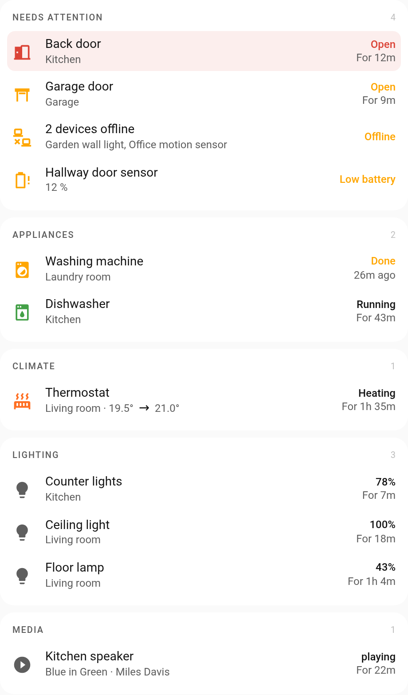
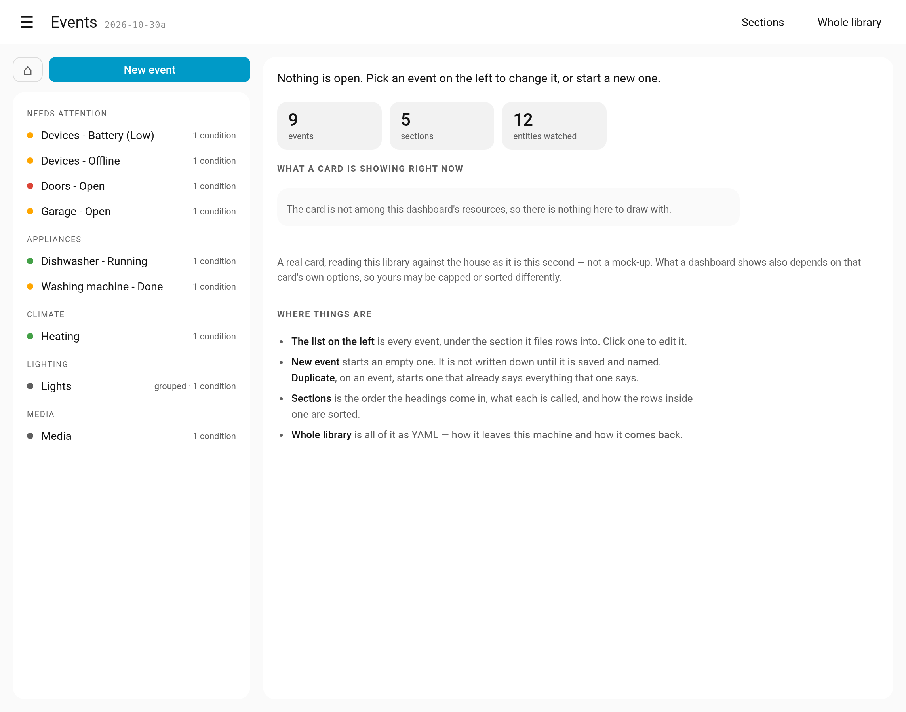
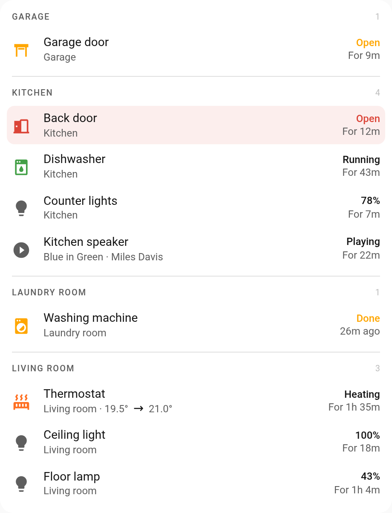

# Home Events

[](https://hacs.xyz/docs/faq/custom_repositories/)
[](LICENSE)

What the house is doing that you would want to know about, in one list.

<picture>
  <source media="(prefers-color-scheme: dark)" srcset="images/events-card-dark.png">
  
</picture>

Not a dashboard of everything. The card is empty when nothing is happening and
says something when it is: a door left open, the washing machine finished, the
heating on, a light still on in the kitchen. Each is one row, and rows are
filed into sections you name.

There are two parts:

- **The library:** every event, saying what it covers, when it applies and how
  its rows read. The integration keeps it, and you edit it in its own sidebar
  panel, **Events**.
- **The card:** `custom:home-event-card` shows the library on a dashboard. It
  comes with the integration and is loaded on every dashboard by itself, so
  there is no resource to add.

<picture>
  <source media="(prefers-color-scheme: dark)" srcset="images/events-panel-dark.png">
  
</picture>

## Installation

### HACS

1. In HACS, open the menu (⋮) > **Custom repositories**.
2. Add `https://github.com/Sandolution/ha-home-events` with the type **Integration**.
3. Install **Home Events** and restart Home Assistant.
4. Go to **Settings > Devices & services > Add integration** and pick
   **Home Events**. There is nothing to fill in.
5. Open **Events** in the sidebar to write the library, and add the card to a
   dashboard:

   ```yaml
   type: custom:home-event-card
   ```

### Manual

1. Copy `custom_components/home_events` from this repository into
   `config/custom_components/`.
2. Restart Home Assistant and add it under **Settings > Devices & services >
   Add integration**.

**Had the card as a separate file before?** Remove the old dashboard resource
that pointed at `/local/custom/home-event-card.js` (Settings > Dashboards > ⋮ >
Resources), and the file itself. The card guards against being defined twice,
so nothing breaks while both are still there.

## Configuration

Adding the integration asks nothing, and it has no options. What the house is
watching lives in the library, edited in the **Events** panel; how it reads on
a dashboard is set on the card.

### The card

```yaml
type: custom:home-event-card
group_by: category
max: 14
collapsible: true
```

| Option | Values | Default | What it does |
|---|---|---|---|
| `type` | `custom:home-event-card` | | **Required.** |
| `group_by` | `category`, `area`, `severity` or `none` | `category` | What the sections are. |
| `sort` | `recent`, `duration` or `name` | the library's `sort` | How rows are ordered within a section, and inside its groups. Set here, it overrides the library. |
| `max` | a whole number, 1 or more | `14` | How many rows the card draws in total, shared out between the sections. |
| `max_per_section` | a whole number, 0 or more | `0` | A hard limit for each section, before the rows are shared out. `0` leaves it to `max`. |
| `hide_when_empty` | `true` or `false` | `false` | Whether the card disappears when nothing is happening. |
| `collapsible` | `true` or `false` | `false` | Whether section headings fold their rows. |
| `promote_alerts` | a section id, or `false` | `alerts` | Where red rows go instead of their own section; `false` leaves them where they are. Only with `group_by: category`. |
| `split_sections` | `true` or `false` | `true` | One card per section with a gap between them, instead of one card. |
| `tidy_names` | `true` or `false` | `false` | Whether the card may shorten friendly names (the first `\|` part becomes the room). |
| `text` | a mapping | | Every word the card writes itself, for translating or rewording. |

Every key under `text`, and what each option does in detail, is in
[docs/home-event-card.md](docs/home-event-card.md#the-card).

The same library, with `group_by: area` and `split_sections: false`:

<picture>
  <source media="(prefers-color-scheme: dark)" srcset="images/events-card-area-dark.png">
  
</picture>

### The library

The library is a list of events. Each one says which entities it covers, in
which state, which section its rows go in and how they read:

```yaml
events:
  washer_done:
    include: {entities: [sensor.washer_state]}
    conditions: [{condition: state, state: done}]
    category: appliances
    severity: attention
    time_mode: ago
```

An event can also group its rows: one per room, one for the lot, or one per
entry in an entity's list attribute, so a sensor that counts things opens into
a row for each of them.

The panel writes this for you. The full format (every key of an event, the
filters, the conditions, grouping, wording per kind of row, colours) is in
[docs/home-event-card.md](docs/home-event-card.md#the-library), as is what the
card exports for other code.

## Requirements

Home Assistant 2024.12 or newer.

## License

[MIT](LICENSE). Built with [Claude Code](https://claude.com/claude-code).
